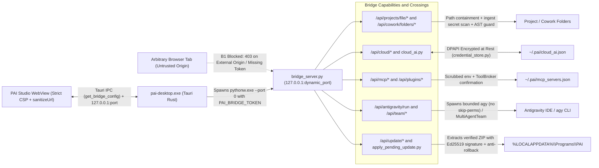
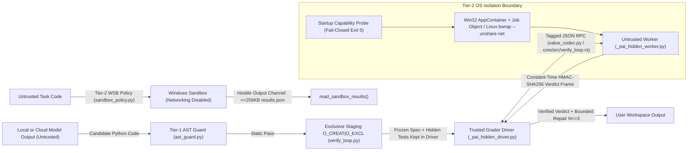
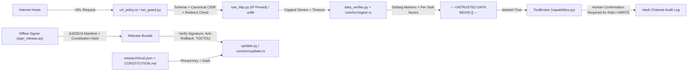

# Trust Boundary Diagram & Inventory

> **Living Security Architecture Document (synced 2026-11-28)**
>
> **Mandatory Maintenance Rule (see [AGENTS.md](../AGENTS.md)):** Whenever any feature, HTTP route, Tauri command, CLI subcommand, IPC channel, network integration, model/cloud provider, MCP server/plugin, automation target, persistent store, or sandbox/updater path is added, modified, or removed, this document and [STRIDE_THREAT_MODEL.md](STRIDE_THREAT_MODEL.md) **must be updated in the same change**.

---

## 1. End-to-End System Trust Boundaries

PAI follows a *defense in depth* architecture separating untrusted inputs, local orchestration, isolated execution, persistent local storage, and the offline-signed trust root. Every guarantee is tied to a named test or a named residual risk in [THREAT_MODEL.md](THREAT_MODEL.md) and [STRIDE_THREAT_MODEL.md](STRIDE_THREAT_MODEL.md).

```mermaid
flowchart TB
    subgraph Z_EXT["External Untrusted Zone"]
        WEB["Public Web / Search / Open-Meteo / Wikipedia"]
        GH["GitHub Releases API and Assets"]
        CLOUD["3rd-Party Cloud AI APIs and Custom Endpoints"]
        EXT_MCP["External MCP Servers (HTTP / STDIO)"]
    end

    subgraph Z_INPUT["Untrusted Local Content and Code Zone"]
        LOCAL_FILES["User Folders, Docs, CSVs, Workspaces"]
        GEN_CODE["Model-Generated Code and Repair Patches"]
    end

    subgraph Z_DESKTOP["Desktop Workstation Shell (Local Loopback)"]
        UI["PAI Studio Frontend (desktop/ui, strict CSP)"]
        TAURI["Tauri 2.0 Shell (pai-desktop.exe)"]
        BRIDGE["Python Bridge Server (127.0.0.1:dynamic_port + X-PAI-Token)"]
        PICKER["Win32 Folder Picker (pai_folder_picker.exe)"]
    end

    subgraph Z_CORE["Core Orchestration and Policy Enforcement"]
        LAUNCHER["Native Launcher (launcher.c / pai.exe)"]
        CLI["PAI CLI and REPL (pai.py / shell.py)"]
        NET_GUARD["Net Guard and Outbound Policy (net_guard.py / url_policy.rs)"]
        INGEST["Ingestion, Secret Scanner and Nonce Envelope (ingest.py / ingest.rs)"]
        RUST_CORE["Rust Policy Core (pai-core --bridge)"]
        ROUTER["Model Router and Config Validator (router.py / config.py)"]
        BROKER["Capability Broker and Audit Chain (capabilities.py)"]
        PURGE["Memory Management & Purge Controller (secure_buffer.py)"]
    end

    subgraph Z_EXEC["Isolated Execution and Local Inference Zone"]
        OLLAMA["Local Ollama Server (127.0.0.1:11434 via ServiceManager)"]
        SANDBOX["Tier-2 OS Sandbox (AppContainer / Bubblewrap / Windows Sandbox)"]
        AUTO_OS["Desktop Automation and Antigravity Driver (ToolBroker Gated)"]
    end

    subgraph Z_STORE["Host Local Persistence (~/.pai and App Install)"]
        MEM_STORE["Auto-Memory, Cowork Tasks, Chat Sessions (Secret-Scanned)"]
        KEY_STORE["Cloud Keys (DPAPI Encrypted at Rest) and Configs"]
        TRUST_ROOT["Trust Root (research/trust.json, CONSTITUTION.md, Updater)"]
    end

    %% Boundary crossings
    WEB <-->|"B2: HTTP(S) / Raw Socket"| NET_GUARD
    NET_GUARD -->|"B2: Sanitized Payload"| INGEST
    LOCAL_FILES -->|"B3: Realpath + Secret Scan"| INGEST
    INGEST -->|"B3: Fenced Nonce Context"| CLI
    INGEST -->|"B3: Fenced Nonce Context"| BRIDGE

    UI <-->|"B1: IPC / WebView (Strict CSP)"| TAURI
    UI <-->|"B1: HTTP + X-PAI-Token on 127.0.0.1:dynamic_port"| BRIDGE
    BRIDGE -->|"B1: Subprocess"| PICKER
    LAUNCHER -->|"B4: BCrypt SHA-256 + Clean Env"| CLI
    CLI <-->|"B4: JSON stdin/stdout"| RUST_CORE
    BRIDGE <-->|"B4: Policy Checks"| RUST_CORE

    ROUTER -->|"B5: Loopback Only + Allow-List"| OLLAMA
    BRIDGE -->|"B5: Loopback via ServiceManager"| OLLAMA
    CLI -->|"B5: Explicit Cloud Routing"| CLOUD
    BRIDGE -->|"B5: Cloud Pool / Net Guard SSRF Guard"| CLOUD

    GEN_CODE -->|"B6: Tier-1 AST + Tagged RPC"| SANDBOX
    CLI -->|"B6: ToolBroker Taint Gate"| BROKER
    BROKER -->|"B6: Allow-Listed Calls"| EXT_MCP
    BRIDGE -->|"B6: Scrubbed Env + ToolBroker Gating"| EXT_MCP
    BRIDGE -->|"B6: App Launch / No Skip-Perms"| AUTO_OS

    CLI -->|"B7: Zeroize on Exit"| PURGE
    BRIDGE <-->|"B7: JSON Persistence"| MEM_STORE
    BRIDGE <-->|"B7: DPAPI Encrypted Keys"| KEY_STORE
    GH -->|"B8: Release Download"| BRIDGE
    GH -->|"B8: Ed25519 + Constitution Check"| TRUST_ROOT
```

---

## 2. Detailed Sub-System Boundary Views

### 2.1 Desktop UI, Loopback Bridge & Local Persistence (`B1`, `B5`, `B7`, `B8`)

### 2.2 Verify-Loop Code Execution & Sandbox Boundary (`B4`, `B6`)

### 2.3 Network Ingestion, Rust Policy Core & Update Trust Root (`B2`, `B3`, `B4`, `B8`)

---

## 3. Trust Boundary Inventory

| Boundary ID | Crossing | Untrusted Side | Trusted Side | Implemented Controls | Primary Source Files | Current Status / Known Gaps |
|---|---|---|---|---|---|---|
| **B1** | Browser / WebView / Local Client ↔ Desktop Bridge & Tauri | Browser pages, WebView DOM, unauthenticated local HTTP callers | `pai-desktop.exe`, `bridge_server.py`, host filesystem | Per-launch `X-PAI-Token` via `hmac.compare_digest` on `/api/*` and `/generated_images/*`, strict `Origin` echo (`tauri.localhost` / loopback port) with `Vary: Origin`, loopback `Host` check (403 on mismatch), ephemeral port (`--port 0`), strict Tauri CSP (`tauri.conf.json`), and DOM link sanitization via `sanitizeUrl`. Covers Deep Think / Cowork lifecycle endpoints (`/api/cowork/tasks/{pause,resume,cancel,graph}`) and native Explorer image save-as (`POST /api/image/save_as`, validating image magic bytes & filename before writing only to user-picked folders). Single-instance Tauri plugin, path containment on project reads/saves. | `desktop/src-tauri/src/main.rs`, `desktop/src-tauri/tauri.conf.json`, `desktop/bridge_server.py`, `desktop/ui/app.js`, `research/cowork.py` | **Mitigated (FINDING-01, FINDING-09, FINDING-12):** Loopback bridge authentication, strict CORS, and CSP active. Residual: UI rendering allows `'unsafe-inline'` styles for custom theme variables. |
| **B2** | External Internet ↔ PAI Network & Grounding | Remote HTTP servers, DNS responses, redirects, HTML/JSON payloads | `DataVerifier`, `SecureBuffer`, Reasoner prompt | `net_guard.py` / `core/src/url_policy.rs` (87 golden vectors, blocked CIDRs incl. IPv6 transition prefixes), `outbound_policy.py` allowlist + `--offline` + visible log, byte/time caps, `DataVerifier` screening, `internet_service.py` and `graphql_agent.py` SSRF validation via `net_guard` and non-loopback cleartext HTTP rejection. Complete offline air-gap mode (`is_internet_enabled()`) immediately fails closed for all web search, live weather, geocoding, grounding, and fact-checking calls with zero socket allocation; interactive UI confirmation modal prompts before disconnect; web search inputs and fact-checking toggle disabled while offline. | `research/net_guard.py`, `core/src/url_policy.rs`, `research/outbound_policy.py`, `research/raw_http.py`, `research/network_pipeline.py`, `research/data_verifier.py`, `research/internet_service.py`, `research/graphql_agent.py`, `desktop/bridge_server.py`, `desktop/ui/app.js` | **Mitigated (FINDING-07, FINDING-13, T36):** SSRF protection and complete fail-closed offline air-gap enforced across search, weather, and fact-checking services. Residual: `raw_http.py` pins validated IPs while standard `urllib` calls perform standard resolution. |
| **B3** | Local Files / Folders ↔ Ingestion & Context Builder | Local repositories, user documents, CSVs, symlinks/junctions | LLM context window, terminal output, export paths | Realpath/junction containment, `is_secret_file` (35+ patterns), `scan_secret_content`, size/file/depth caps, `sanitize_terminal_output` (OSC/C1/bidi strip), cryptographic nonce envelopes (`[[SRC:<nonce>:<src>]]`). Desktop endpoints (`get_project_codebase_context`, `_handle_project_file_content`, `_handle_project_file_save`) enforce `is_secret_file`, `scan_secret_content`, symlink rejection, and `ast_guard` on `.py`. | `research/ingest.py`, `core/src/ingest.rs`, `research/pai.py`, `desktop/bridge_server.py`, `research/multi_agent.py` | **Mitigated (FINDING-04, FINDING-08):** Ingestion and codebase context filter secrets and reject symlink traversal across CLI and Desktop. |
| **B4** | Python Orchestrator ↔ Native Rust / C Launcher & Win32 | Caller environment (`PYTHONPATH`, `PAI_CORE_SHA256`), IPC payloads | `pai-core.exe`, `pai.py`, Win32 telemetry | `launcher.c` BCrypt SHA-256 check of `pai-core.exe` vs `manifest.json`, clears `PYTHONPATH`/`PYTHONHOME`/`PYTHONSTARTUP`, safe DLL search order; `pai_core_bridge.py` shadow differential comparison + `ast.parse` re-check; `#![deny(unsafe_code)]` outside `core/src/win32.rs`. | `packaging/launcher/launcher.c`, `research/pai_core_bridge.py`, `core/src/bridge.rs`, `core/src/win32.rs`, `core/src/lib.rs` | **Mitigated (CLI) / Partial (Direct Python):** Direct `python research/pai.py` or `desktop/bridge_server.py` bypasses `launcher.c`; `hardware/` C++ telemetry daemon named-pipe ACL (T9) remains Phase 2 work. |
| **B5** | Orchestrator ↔ Local Ollama & Cloud AI Providers | Untrusted prompts/context, model responses, remote cloud APIs, edited configs, local C++ sidecar weights | Model router, API keys, host RAM/VRAM | `router.py` CLI-only task class + verified catalog allowlist; `thinking_engine.compute_adaptive_context_budget` scales Ollama `num_ctx` by `HardwareTelemetry` tier (clamped `<= 4096` on `COMPRESSED` to bound host OOM); `service_manager.py` pinned `%LOCALAPPDATA%\Programs\Ollama\ollama.exe` + WinVerifyTrust + `OLLAMA_HOST=127.0.0.1:11434`; `local_sidecars.py` & `sidecar_installer.py` manage loopback `llama.cpp` (`127.0.0.1:11435` for Ternary Bonsai 2.5 `Q2_0`/`PTQ1_0`) and `stable-diffusion.cpp` (`sd-cli.exe` for `FLUX.1-schnell`, `SDXL-Turbo`, `SD-Turbo`) strictly without `PATH` lookup, enforcing Gate 1 disk/HW checks (`assess_install_and_run_readiness`), Gate 3 RAM/VRAM admission (`check_runtime_admission`), zip-slip/symlink/SSRF archive guards, custom `models_path` storage sync, and PNG/JPEG header validation; `cloud_ai.py` encrypts keys at rest via DPAPI (`credential_store.py`), masks keys, validates endpoints via `net_guard`, and enforces offline air-gap fail-closed blocking. | `research/router.py`, `research/thinking_engine.py`, `research/hardware_telemetry.py`, `research/service_manager.py`, `research/local_sidecars.py`, `research/sidecar_installer.py`, `research/config.py`, `research/cloud_ai.py`, `research/credential_store.py`, `research/quota_engine.py`, `desktop/bridge_server.py`, `desktop/ui/app.js` | **Mitigated (FINDING-07, FINDING-10, FINDING-11, T36, T40):** Ollama + local sidecars restricted to loopback and pinned directories with 3-gate disk/RAM/VRAM checks and archive extraction bounds; adaptive context windows bounded by hardware tier; cloud keys encrypted via DPAPI; offline air-gap enforces local fallback. Residual: remote AI provider server-side data retention policies are external. |
| **B6** | Reasoner / User Commands ↔ Code Sandboxes, MCP & OS Automation | Model-generated code, external MCP servers (STDIO + HTTP/SSE), custom plugins / `SKILL.md`, `agy` agent, desktop apps, screen/UIA text | Host OS, user files, credentials, network | `ast_guard.py` (Tier 1), `sandbox_win32.py` (AppContainer + Job Object), `sandbox_linux.py` (`bwrap --unshare-net` + rlimits), fail-closed startup probe, two-process driver/worker + HMAC-SHA256 verdict frame (`verify_loop.rs`), `ToolBroker` (`capabilities.py`). `mcp_client.py` and `mcp_hub.py` scrub child env vars to strict allowlists (injecting vaulted tokens only via DPAPI `MCPVaultManager`), validate remote HTTP/SSE endpoints via `net_guard`, block unpinned `npx -y` and shell interpreters, enforce `MCPServerPolicy` (`read_only`, `lockdown_mode`, `toolsets`), reject secret-harvesting `elicitation` Form schemas, redact secrets/markers from tool/resource outputs (`tainted=True`), and log every call in `ToolFirewall`. `plugin_manager.py` scans custom plugins and `SKILL.md` bundles via `PluginScanner` prior to enabling (`test_mcp_and_plugin_ecosystem.py`). Role-scoped Agent Cards in `multi_agent.py` enforce read-only MCP boundaries for Planner/QA roles. `antigravity_driver.py`, `automation.py`, `desktop_control.py`, and `windows_mcp_server.py` gate all OS actions via `ToolBroker` and explicit HITL confirmation. | `research/ast_guard.py`, `research/sandbox_win32.py`, `research/sandbox_linux.py`, `research/sandbox_policy.py`, `research/verify_loop.py`, `core/src/verify_loop.rs`, `research/capabilities.py`, `research/mcp_client.py`, `research/mcp_hub.py`, `research/plugin_manager.py`, `research/context_engine.py`, `research/multi_agent.py`, `research/automation.py`, `research/desktop_control.py`, `research/windows_mcp_server.py`, `research/desktop_orchestrator.py`, `desktop/bin/pai_ui_agent.cs`, `research/antigravity_driver.py`, `desktop/bridge_server.py` | **Mitigated (FINDING-04, FINDING-05, FINDING-06, T33, T37, T39):** MCP transports (STDIO + Streamable HTTP/SSE), plugins/skills, OS automation, and UIA steering gated by ToolBroker/ToolFirewall confirmation, SSRF guards, PluginScanner, DPAPI vault, and HITL modals. Residual: AppContainer is weaker than full hardware-virtualized Hyper-V microVM; desktop input and local STDIO MCP servers operate within the active user session. |
| **B7** | Ephemeral RAM ↔ Persistent Local Storage (`~/.pai`) | Working RAM buffers, swap/pagefile, crash dumps, untrusted session content, reasoning graphs | User privacy, credentials, future prompts | `SecureBuffer` wipe-and-verify (`finally` in `agent_core.py`), CLI shell `/history` memory-only. `credential_store.py` protects keys at rest using DPAPI (`CryptProtectData`) on Windows with atomic 0o600 fallback on POSIX. `auto_memory.py` scans and blocks secrets before persistence and defangs XML-like injection markers. `thought_graph.py` (`ThoughtGraph`, `SubconsciousBlackboard`) and `crash_reasoning_mcp.py` (`CRASHTracker`) sanitize all nodes via `ingest.scan_secret_content` and `defang_envelope_markers` and persist atomically under `~/.pai/cowork/`; `cowork.py` enforces `StuckDetectorWatchdog` stall bounds and objective quality checks (`verify_task_quality`). | `research/secure_buffer.py`, `research/agent_core.py`, `research/auto_memory.py`, `research/credential_store.py`, `research/cowork.py`, `research/thought_graph.py`, `research/crash_reasoning_mcp.py`, `desktop/bridge_server.py` | **Mitigated (FINDING-08, FINDING-11, T30b, T38):** Sensitive credentials encrypted at rest; auto-memory, ThoughtGraph, and SubconsciousBlackboard screened for secrets and defanged; long-horizon loops bounded by watchdog. Residual: unswappable RAM zeroization for Python runtime allocations relies on OS page zeroing. |
| **B8** | External Releases & Trust Root ↔ Updaters & Installers | GitHub release JSON, downloaded `.zip` payloads, staged update files | Install directory (`%LOCALAPPDATA%\Programs\PAI`), `trust.json`, `CONSTITUTION.md` | `research/updater.py` & `core/src/updater.rs`: Ed25519 manifest signature, revocation check, anti-rollback version, pinned Constitution SHA-256, per-file SHA-256, TOCTOU check, `trust_root_is_protected()`; `desktop/bridge_server.py` screens update URLs via `net_guard`, fetches `manifest.json` / optional `manifest.sig`, verifies archive SHA-256 + byte size + 250 MiB cap before staging; `desktop/apply_pending_update.py` invokes `research.updater.Updater` whenever `manifest.sig` or `PAI_REQUIRE_SIGNED_UPDATE=1` is present, and for CI-built GitHub releases without `manifest.sig` verifies `manifest.json` SHA-256, SemVer non-downgrade, and traversal/symlink/zip-bomb guards before syncing UI, Tauri, and `research/` modules. | `research/updater.py`, `core/src/updater.rs`, `core/src/ed25519.rs`, `research/trust.json`, `docs/CONSTITUTION.md`, `desktop/bridge_server.py`, `desktop/apply_pending_update.py`, `tools/package_release.py`, `packaging/build_payload.py`, `tools/check_pins.py` | **Mitigated (FINDING-03 / Honest Scope):** Signed releases enforce Ed25519 + Constitution verification; CI-built GitHub releases verify HTTPS + `manifest.json` SHA-256 + non-downgrade + archive safety. Residual: CI-built releases lack offline `release.key` Ed25519 signatures unless `PAI_REQUIRE_SIGNED_UPDATE=1` is paired with signed artifacts. |
